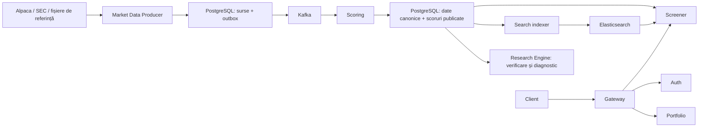

# Planul aplicației

## Motivație

Platforma ajută la compararea acțiunilor din S&P 500 și Nasdaq-100 prin scoruri
explicabile de **Value, Quality și Momentum**. Păstrează datele sursă, versiunea
modelului și motivele excluderilor, astfel încât un rezultat să poată fi reprodus.
Proiectul servește și învățării arhitecturii cu microservicii, Kafka și Elasticsearch.

Formula și datele folosite sunt explicate în [MODEL.md](MODEL.md).

## Componente

| Componentă | Rol | Port local Docker implicit |
|---|---|---|
| [Gateway](GATEWAY-SERVICE.md) | Intrare HTTP, autentificare și rutare | 18080 |
| [Auth](AUTH-SERVICE.md) | Conturi și tokenuri JWT | 18081 |
| [Screener](SCREENER-SERVICE.md) | Clasamente și căutare de companii | 18082 |
| [Portfolio](PORTFOLIO-SERVICE.md) | Deținerile fiecărui utilizator | 18083 |
| [Market Data Producer](MARKET-DATA-PRODUCER.md) | Colectare de prețuri și raportări financiare | 18084 |
| [Scoring](SCORING-SERVICE.md) | Consum Kafka, date canonice și calculul scorurilor | 18085 |
| [Database Migrations](DATABASE-MIGRATIONS.md) | Aplică schema Flyway, apoi se oprește | Fără HTTP |
| [Research Engine](RESEARCH-ENGINE.md) | Model Python, verificare cu Java și cercetare | CLI, fără HTTP |
| Search indexer | Proces separat al Screener; reconstruiește căutarea | Fără port public |
| PostgreSQL / TimescaleDB | Sursa de adevăr: date, utilizatori și rezultate | 6543 |
| Kafka + ZooKeeper | Transportul evenimentelor și coordonarea brokerului | Kafka: 9092 |
| Elasticsearch | Index de căutare refăcut din PostgreSQL | 9200 |

Serviciile folosesc o singură bază de date, cu roluri și permisiuni separate.
Modulele `ingestion-contract`, `security-common` și `observability-common`
sunt biblioteci comune, nu procese Docker separate. Prometheus și backupul automat
sunt servicii opționale, definite în overlay-urile Compose dedicate.

## Flow-ul aplicației



1. Se importă listele datate ale indicilor, identitățile instrumentelor și calendarul.
2. Producer descarcă datele, păstrează sursele și trimite evenimentele prin outbox/Kafka.
3. Scoring elimină efectele mesajelor duplicate și salvează datele canonice.
4. Cu date suficiente, calculează întregul univers și publică atomic scorurile și excluderile.
5. Screener livrează clasamentul publicat; indexerul actualizează căutarea.
6. Utilizatorul face login, consultă rezultatele și își gestionează deținerile.

Datele sunt selectate după momentul în care erau cunoscute. O descărcare făcută
astăzi nu devine automat informație disponibilă pentru un scor din trecut.

## Tabelele principale

| Tabel / grup de tabele | Ce păstrează |
|---|---|
| `public.users` | Conturi și hashuri de parole |
| `public.portfolios` | Dețineri legate de utilizator |
| `reference.issuers`, `reference.instruments`, `reference.exchanges` | Companii, instrumente și burse |
| `reference.instrument_identifiers`, `reference.instrument_symbols` | Identificatori stabili și istoricul simbolurilor |
| `reference.universes`, `reference.universe_snapshots`, `reference.universe_memberships` | Componența datată a indicilor |
| `reference.trading_sessions` | Sesiuni, sărbători și ore de tranzacționare |
| `reference.classification_versions`, `reference.issuer_classifications` | Sectoare și clasificări versionate |
| `operations.data_providers`, `operations.datasets`, `operations.job_definitions` | Surse și definițiile colectărilor |
| `operations.ingestion_runs`, `operations.ingestion_run_items`, `operations.ingestion_attempts`, `operations.ingestion_checkpoints` | Progres, încercări și reluarea colectării |
| `operations.source_artifacts`, `operations.outbox_events`, `operations.kafka_inbox` | Date sursă, livrare și deduplicare |
| `operations.data_coverage`, `operations.data_watermarks`, `operations.data_quality_issues` | Acoperire, actualitate și probleme de date |
| `operations.dead_letter_records`, `operations.dead_letter_replays` | Mesaje respinse și reluări auditate |
| `market_data.daily_bar_observations`, `market_data.corporate_actions` | Prețuri zilnice, ajustări, dividende și splituri |
| `fundamentals.filings`, `fundamentals.fundamental_facts`, `fundamentals.instrument_share_facts` | Raportări, indicatori și număr de acțiuni |
| `fundamentals.metric_definitions`, `fundamentals.source_metric_mappings` | Semantica indicatorilor și maparea surselor |
| `fundamentals.profile_observations`, `fundamentals.regulatory_facts` | Date specifice profilurilor și raportări de reglementare |
| `research.model_versions`, `research.model_parity_certifications` | Modelul și verificarea implementării |
| `research.scoring_runs`, `research.stock_scores` | Execuții de calcul și rezultatele pe instrument |
| `research.factor_observations`, `research.score_exclusions` | Factorii calculați și motivele excluderilor |
| `research.score_lineage`, `research.score_source_artifacts` | Legătura dintre fiecare scor, input și sursă |
| `operations.search_rebuild_checkpoints` | Ultima reconstruire completă a căutării |

Tabelele vechi `public.market_bars`, `public.fundamental_snapshots` și
`public.factor_scores` sunt încă folosite de codul legacy din Scoring și Python.
Clasamentul actual citește publicațiile din schema `research`. V019 elimină
`public.tick_data`, `operations.month_end_score_jobs` și schemele goale `identity`,
`portfolio`; conturile și deținerile rămân în schema `public`.
Definițiile complete sunt în [migrările SQL](../database-migrations/src/main/resources/db/migration).

## Utilizare locală

Cerințe: JDK 25, Docker Desktop și, pentru cercetare, Python 3.11–3.14.
Configurația locală pornește de la [exemplul de mediu](../infrastructure/.env.example);
datele de acces se păstrează în `infrastructure/.env`. Comenzile se rulează din rădăcina repo-ului:

```powershell
docker compose -f infrastructure/docker-compose.yml -f infrastructure/docker-compose.local.yml --profile application up --build -d
docker compose -f infrastructure/docker-compose.yml -f infrastructure/docker-compose.local.yml --profile application ps -a
```

Construirea imaginilor și pornirea serviciilor nu înlocuiesc importul de referințe,
configurarea furnizorilor și publicarea unui scor. Începe cu
[catalogul endpointurilor](ENDPOINTS.md) pentru register, login și rankings.
Overlay-ul `local` folosește configurări exclusiv pentru dezvoltare.

## Stadiu și următorii pași

Modelul actual este **1.2.0**, iar schema sursă ajunge la **V019**. Există un snapshot
de cercetare publicat local la 1 octombrie 2026; detalii în [Scoring](SCORING-SERVICE.md).
Modelul este `FROZEN_RESEARCH_HYPOTHESIS`, cu acceptarea istorică `NOT_EVALUATED`.

Pașii rămași sunt extinderea datelor pentru profiluri financiare/REIT, istoricul
complet pentru validarea modelului, o interfață web și pregătirea unei găzduiri publice.
Portofoliul stochează dețineri; aplicația nu execută ordine la broker.

Diagrama originală [Platform design plan.svg](Platform%20design%20plan.svg)
este păstrată ca atare. Documentația de aici descrie implementarea actuală.
